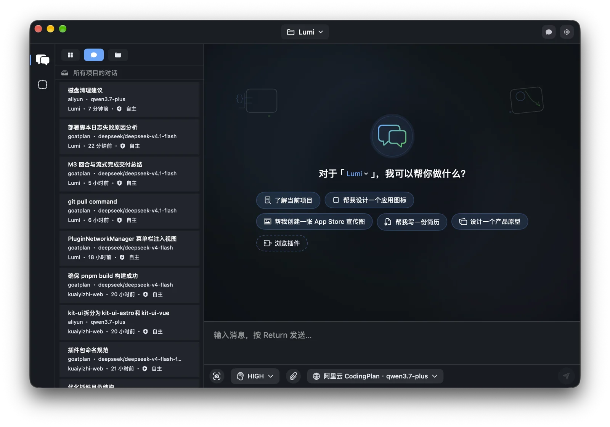
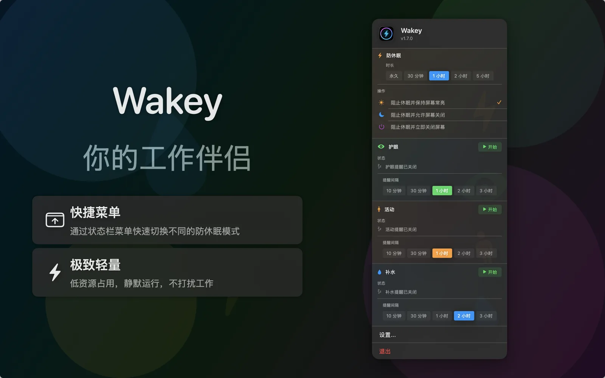

<div align="center">


# Lumi Softworks

**The Lumi family of software — one plugin-driven kernel, many macOS apps**

English · [简体中文](./README.zh.md)

[](https://github.com/lumi-softworks/Lumi)
[](https://github.com/lumi-softworks/Wakey)
[](https://swift.org)
[](https://developer.apple.com/macos/)

</div>

---

## About Us

Lumi Softworks is an independent software team focused on **Apple platforms**. Around a self-built plugin kernel, we craft a family of macOS applications that collaborate with each other while remaining independently runnable.

Both our flagship **Lumi** (AI desktop assistant) and the lightweight **Wakey** (status bar companion) are built on the same kernel, Provider contracts and design system. This means **a single plugin can ship in multiple applications** — the Eye Care, Hydration and Stretch reminder plugins, for instance, share one implementation across Lumi and Wakey.

<div align="center">
  
</div>

## Our Products

### 🧠 [Lumi](https://github.com/lumi-softworks/Lumi)

**An AI-powered macOS desktop assistant** — LLM chat, a tool-using agent, a code editor, a terminal, and a broad set of system and developer tools, all in one app.

- **Multi-provider LLM chat** — 20+ built-in provider integrations (OpenAI, Anthropic, DeepSeek, Zhipu, MiniMax, Kimi Code, Aliyun, StepFun, Xiaomi, OpenRouter, plus local MLX models)
- **Agent with tool use** — read and edit files, run shell commands, fetch and search the web, drive a browser and the computer, inspect images, and ask the user for input mid-task
- **Built-in code editor** — project file tree, syntax highlighting, fuzzy file search, outline, references, call hierarchy, problems, language services, and Markdown preview
- **Developer tools** — native terminal, Git/GitHub integration, SQLite/MySQL/PostgreSQL/Redis, Docker, Homebrew, ports and hosts management
- **System utilities** — clipboard history, disk and network monitoring, screen recording, OCR, display control, anti-sleep, downloads, and more
- **Project intelligence** — project-scoped rules, skills, memory, file search, and local vector-based RAG for code questions
- **Themes and customization** — 100+ default plugins, runtime enable/disable, and 22 built-in themes
- **Local HTTP API** — a built-in web server on the loopback interface aggregating routes contributed by plugins

<div align="center">
  
</div>

### ⚡ [Wakey](https://github.com/lumi-softworks/Wakey)

**A lightweight macOS status bar assistant** — always one click away in the menu bar, with one-tap anti-sleep and timed Eye Care, Hydration and Stretch reminders.

- **Anti-sleep control** — block system sleep in a single click, with flexible modes and duration presets
- **Break reminders** — Eye Care / Hydration / Stretch reminders with configurable intervals and a full-screen break overlay on every display
- **Menu bar resident** — access every feature without switching windows
- **Plugin-based design** — shares the same kernel and shared plugin packages as Lumi
- **Low footprint** — runs quietly and barely interrupts your workflow

> **In the pipeline** — more Lumi-family applications are in development and will move into this organization over time.

## Shared Packages

Much of what Lumi and Wakey can do comes from shared components designed as **independently publishable Swift Packages**. Host applications consume them as remote packages through Swift Package Manager.

### Core Architecture

| Repository | Description |
| :--- | :--- |
| [`LumiKernel`](https://github.com/lumi-softworks/LumiKernel) | Application-agnostic plugin kernel: typed Provider registration and plugin lifecycle management |
| [`LumiProviders`](https://github.com/lumi-softworks/LumiProviders) | Shared Provider contracts and default implementations (conversations, LLMs, tools, projects, storage, web routes…) |
| [`LumiUI`](https://github.com/lumi-softworks/LumiUI) | SwiftUI design system and component library for macOS, iOS and visionOS |

### Capability Kits

| Repository | Description |
| :--- | :--- |
| [`LumiKitReminder`](https://github.com/lumi-softworks/LumiKitReminder) | Generic break-reminder infrastructure (shared by Eye Care, Hydration and Stretch) |
| [`LumiThemePack`](https://github.com/lumi-softworks/LumiThemePack) | Shared theme catalog and theme settings interface |
| [`LumiSettings`](https://github.com/lumi-softworks/LumiSettings) | Shared settings Provider contracts and SwiftUI navigation |
| [`LumiLocalization`](https://github.com/lumi-softworks/LumiLocalization) | Shared localization lookup package |
| [`LumiLogging`](https://github.com/lumi-softworks/LumiLogging) | Shared logging primitives and in-app log collection |
| [`LumiStoreKit`](https://github.com/lumi-softworks/LumiStoreKit) | StoreKit 2 lifecycle utilities |
| [`LumiIllustrations`](https://github.com/lumi-softworks/LumiIllustrations) | Shared PNG illustration assets |

### Shared Plugins

These plugins are assembled as remote packages by multiple host applications:

| Repository | Description |
| :--- | :--- |
| [`LumiPluginEyeCareReminder`](https://github.com/lumi-softworks/LumiPluginEyeCareReminder) | Eye Care reminder — shared by Lumi and Wakey |
| [`LumiPluginHydrationReminder`](https://github.com/lumi-softworks/LumiPluginHydrationReminder) | Hydration reminder — shared by Lumi and Wakey |
| [`LumiPluginStretchReminder`](https://github.com/lumi-softworks/LumiPluginStretchReminder) | Stretch reminder — shared by Lumi and Wakey |
| [`LumiPluginAbout`](https://github.com/lumi-softworks/LumiPluginAbout) | About plugin (official website, privacy policy, terms of service) |
| [`LumiPluginPluginManager`](https://github.com/lumi-softworks/LumiPluginPluginManager) | Plugin manager — browse, enable and inspect registered plugins |
| [`LumiPluginSettingView`](https://github.com/lumi-softworks/LumiPluginSettingView) | Settings page shell and sidebar navigation |
| [`LumiPluginThemeManager`](https://github.com/lumi-softworks/LumiPluginThemeManager) | Theme manager — creates and persists the theme Provider |
| [`LumiPluginThemePack`](https://github.com/lumi-softworks/LumiPluginThemePack) | Lumi-side theme pack adapter layer |
| [`LumiPluginStorage`](https://github.com/lumi-softworks/LumiPluginStorage) | Shared storage super plugin |
| [`LumiPluginToast`](https://github.com/lumi-softworks/LumiPluginToast) | Reusable Toast implementation |
| [`LumiBookletMaker`](https://github.com/lumi-softworks/LumiBookletMaker) | Booklet Maker domain logic (across Lumi / GameFactory) |
| [`LumiPluginBookletMaker`](https://github.com/lumi-softworks/LumiPluginBookletMaker) | Booklet Maker plugin layer |

## Architecture Principles

```
        ┌──────────────┐   ┌──────────────┐
        │     Lumi     │   │    Wakey     │   ... more apps
        └──────┬───────┘   └──────┬───────┘
               │                  │
        ┌──────▼──────────────────▼───────┐
        │        LumiKernel kernel        │  Provider registry · plugin lifecycle
        └──────▲──────────────────▲───────┘
               │                  │
    ┌──────────┴───┐      ┌───────┴────────┐
    │ LumiProviders│      │    LumiUI      │  contracts · design system
    └──────────────┘      └────────────────┘
               ▲
    ┌──────────┴───────────────────────────┐
    │   shared plugins / kits (remote SPM)  │
    │  eye care · hydration · stretch · ... │
    └──────────────────────────────────────┘
```

- **Contracts first** — plugins never depend on concrete implementations; they talk to the host through `Provider*` contracts
- **One plugin, one package** — each plugin is a standalone Swift Package, independently versioned, published and consumed by multiple apps
- **A tiny kernel** — the kernel only handles registration, resolution and lifecycle; it knows nothing about any specific domain

## Contributing

Issues and pull requests are welcome.

- **Report a bug or propose a feature** → open an issue in the corresponding repository
- **Contribute code** → read the repository's `README` and `AGENTS.md` conventions first
- **Add a shared plugin** → follow the [plugin package structure guide](https://github.com/lumi-softworks/.github) to keep package layouts consistent

## License

Each repository carries its own license:

| Repository | License |
| :--- | :--- |
| [`Lumi`](https://github.com/lumi-softworks/Lumi) | GPL-3.0 |
| [`Wakey`](https://github.com/lumi-softworks/Wakey) | GPL-3.0 |
| [`LumiKernel`](https://github.com/lumi-softworks/LumiKernel) | GPL-3.0 |
| [`LumiUI`](https://github.com/lumi-softworks/LumiUI) | MIT |
| [`LumiSettings`](https://github.com/lumi-softworks/LumiSettings) | MIT |
| [`LumiLogging`](https://github.com/lumi-softworks/LumiLogging) | MIT |
| [`LumiStoreKit`](https://github.com/lumi-softworks/LumiStoreKit) | MIT |
| [`LumiIllustrations`](https://github.com/lumi-softworks/LumiIllustrations) | MIT |
| Remaining shared packages | See the `LICENSE` file in each repository |

> A few shared packages do not yet ship a `LICENSE` file; they will be unified during the migration.

## Links

- 🏠 Website — <https://coffic.cn>
- 🐦 Contact — <https://github.com/nookery>

---

<div align="center">
  <sub>Built with Swift and ❤️ by <a href="https://github.com/lumi-softworks">Lumi Softworks</a></sub>
</div>
